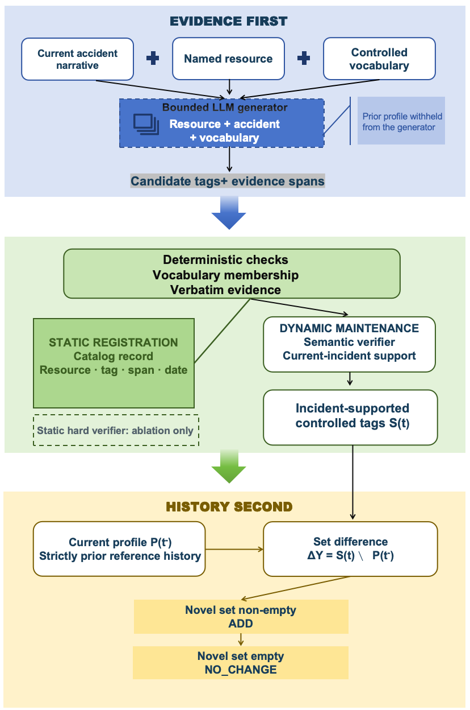

# IGDST

IGDST extracts safety knowledge about specific resources, such as chemicals, equipment, and consumables, from industrial accident narratives. It uses a controlled vocabulary to describe hazards, operation stages, and accident types, and links each label to an evidence span in the narrative.

## Framework



1. **Prepare the input.** Clean the narrative, identify candidate resources, and normalize their names.
2. **Propose labels and check evidence.** For each resource, generate candidate labels and supporting text. Check that each label belongs to the vocabulary and that the evidence span appears in the narrative.
3. **Record or update.** Static tagging records the labels and evidence for the current accident. Dynamic updating adds a semantic check for support, then compares the supported labels with the resource's prior profile. It returns `ADD` with the new labels if any remain, or `NO_CHANGE` if the set is empty.

## Run the offline example

From the repository root, use Python 3.10 or later to run rule-based preprocessing on the included synthetic accident:

```bash
IGDST_RESULTS_DIR=/tmp/igdst_example python scripts/preprocess.py \
  --source examples/accident_example.csv --mode rules
```

This command writes the cleaned narrative, resource mentions, resource dictionary, and candidate pairs to `/tmp/igdst_example/ihms/preparation/`. To install dependencies for the other workflows, run `python -m pip install -r requirements.txt`.

## Repository layout

| Path | Contents |
| --- | --- |
| [`scripts/`](scripts/) | Preprocessing, data preparation, static tagging, dynamic updating, and evaluation |
| [`prompts/`](prompts/) | Prompts for resource extraction, label generation, and evidence verification |
| [`config/`](config/) | Controlled vocabulary, label mappings, resource rules, and dataset settings |
| [`examples/`](examples/) | One synthetic accident narrative in CSV format |
